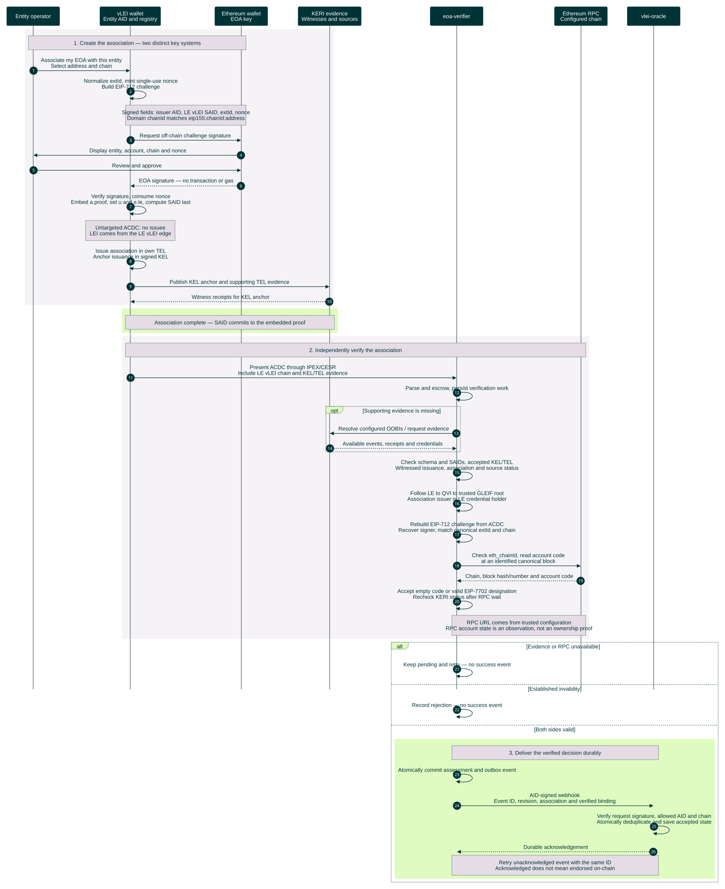

# EOA association creation and verification

Proposed design. A legal entity operator uses an Ethereum wallet and a vLEI wallet controlling the entity's AID. The entity already holds a valid LE vLEI. The Ethereum proof is embedded before issuance; `eoa-verifier` independently checks both sides before notifying `vlei-oracle`.

[Open the rendered chart](association-verification-sequence.svg). Dark teal participants, lavender notes and green completion bands follow the methodology's sequence diagram.



<details>
<summary>Editable Mermaid source</summary>

Render exports on an opaque white canvas to preserve this palette in light and dark viewers.

```text
%%{init: {"theme":"base","fontFamily":"Arial, sans-serif","themeCSS":"text { font-family: Arial, sans-serif !important; }","themeVariables":{"fontFamily":"Arial, sans-serif","primaryColor":"#003336","primaryTextColor":"#FFFFFF","primaryBorderColor":"#003336","lineColor":"#6A7B7F","actorBkg":"#003336","actorBorder":"#003336","actorTextColor":"#FFFFFF","actorLineColor":"#6A7B7F","signalColor":"#003336","signalTextColor":"#003336","labelBoxBkgColor":"#DFFBC0","labelBoxBorderColor":"#6A7B7F","labelTextColor":"#003336","loopTextColor":"#003336","noteBkgColor":"#E5DCE6","noteBorderColor":"#6A7B7F","noteTextColor":"#003336","sequenceNumberColor":"#FFFFFF"},"sequence":{"mirrorActors":false,"actorMargin":28,"width":155,"height":55,"messageMargin":24,"noteMargin":12,"diagramMarginX":20,"diagramMarginY":20,"wrap":false,"actorFontFamily":"Arial","messageFontFamily":"Arial","noteFontFamily":"Arial"}}}%%
sequenceDiagram
    autonumber
    participant U as Entity operator
    participant VW as vLEI wallet<br/>Entity AID and registry
    participant EW as Ethereum wallet<br/>EOA key
    participant W as KERI evidence<br/>Witnesses and sources
    participant V as eoa-verifier
    participant RPC as Ethereum RPC<br/>Configured chain
    participant O as vlei-oracle

    rect rgb(246, 243, 247)
        Note over U,EW: 1. Create the association — two distinct key systems
        U->>VW: Associate my EOA with this entity<br/>Select address and chain
        VW->>VW: Normalize extId, mint single-use nonce<br/>Build EIP-712 challenge
        Note over VW,EW: Signed fields: issuer AID, LE vLEI SAID, extId, nonce<br/>Domain chainId matches eip155:chainId:address
        VW->>EW: Request off-chain challenge signature
        EW->>U: Display entity, account, chain and nonce
        U->>EW: Review and approve
        EW-->>VW: EOA signature — no transaction or gas
        VW->>VW: Verify signature, consume nonce<br/>Embed a.proof, set u and e.le, compute SAID last
        Note over VW: Untargeted ACDC: no issuee<br/>LEI comes from the LE vLEI edge
        VW->>VW: Issue association in own TEL<br/>Anchor issuance in signed KEL
        VW->>W: Publish KEL anchor and supporting TEL evidence
        W-->>VW: Witness receipts for KEL anchor
    end
    rect rgb(223, 251, 192)
        Note over VW,W: Association complete — SAID commits to the embedded proof
    end

    rect rgb(246, 243, 247)
        Note over VW,RPC: 2. Independently verify the association
        VW->>V: Present ACDC through IPEX/CESR<br/>Include LE vLEI chain and KEL/TEL evidence
        V->>V: Parse and escrow, persist verification work
        opt Supporting evidence is missing
            V->>W: Resolve configured OOBIs / request evidence
            W-->>V: Available events, receipts and credentials
        end
        V->>V: Check schema and SAIDs, accepted KEL/TEL<br/>Witnessed issuance, association and source status
        V->>V: Follow LE to QVI to trusted GLEIF root<br/>Association issuer is LE credential holder
        V->>V: Rebuild EIP-712 challenge from ACDC<br/>Recover signer, match canonical extId and chain
        V->>RPC: Check eth_chainId, read account code<br/>at an identified canonical block
        RPC-->>V: Chain, block hash/number and account code
        V->>V: Accept empty code or valid EIP-7702 designation<br/>Recheck KERI status after RPC wait
        Note over V,RPC: RPC URL comes from trusted configuration<br/>RPC account state is an observation, not an ownership proof
    end

    alt Evidence or RPC unavailable
        V->>V: Keep pending and retry — no success event
    else Established invalidity
        V->>V: Record rejection — no success event
    else Both sides valid
        rect rgb(223, 251, 192)
            Note over V,O: 3. Deliver the verified decision durably
            V->>V: Atomically commit assessment and outbox event
            V->>O: AID-signed webhook<br/>Event ID, revision, association and verified binding
            O->>O: Verify request signature, allowed AID and chain<br/>Atomically deduplicate and save accepted state
            O-->>V: Durable acknowledgement
            Note over V,O: Retry unacknowledged event with the same ID<br/>Acknowledged does not mean endorsed on-chain
        end
    end
```

</details>

The webhook carries the association SAID, issuer AID, LE vLEI SAID, canonical `extId`, verdict, revision, issuance-order facts and observation time/block. The oracle derives `wallet` from `extId` and `identityRef = keccak256(issuerAid)`; it checks request authenticity and deployment scope rather than repeating association-proof verification. Its verifier AID allowlist is configured: OOBI discovery alone does not authorize a caller.

EOA key control is proven at ceremony time. Account-state queries cannot detect a sold or stolen private key; credential revocation and a relying party's re-association/recency policy address that limit. Optional on-chain publication of the association pointer is omitted: it is not needed to complete or verify the association.

Sources: [EOA profile](/Users/kbull/gleif/projects/vlei-external-association/initial-docs-from-kevin/eoa-profile.docx), [methodology and original color theme](/Users/kbull/gleif/projects/vlei-external-association/initial-docs-from-kevin/methodology.docx), and [current EIP-712 profile](../../gl1/vlei-oracle/protocol/external-association-v1/eoa-v1/README.md). The documents permit other challenge carriers; this design selects EIP-712 from our agreed plan. Webhook delivery is the proposed extraction boundary.
