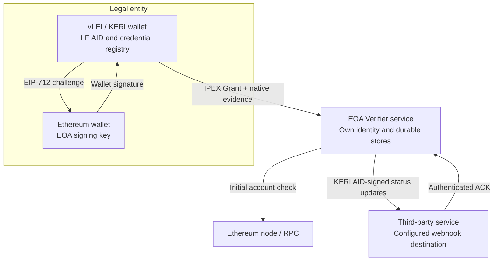
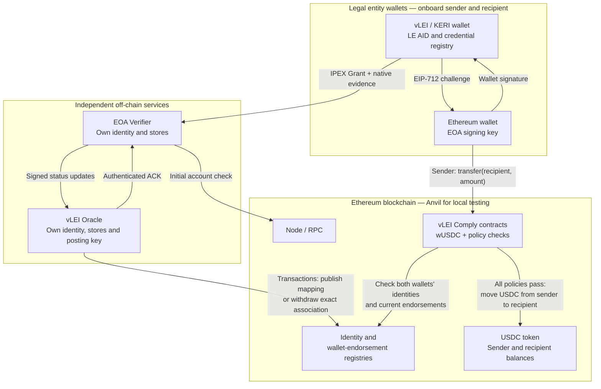

# Deployment models

Deployment models for the completed buildout. Boxes group wallet applications,
independent services and on-chain contracts; arrows show their interactions.

## 1. EOA Verifier with a third-party webhook

The KERI wallet embeds the EIP-712 proof, issues the untargeted ACDC and presents the
association with its native evidence, including the LE/QVI chain. The verifier
performs initial verification and stores acceptance. Later, verified native
revocation evidence retires the association and produces a separate status update.
Each webhook event requires an authenticated ACK after durable receipt; failed
deliveries remain pending and retry with backoff. No Ethereum transaction is needed
for the challenge signature.

## 2. EOA Verifier, vLEI Oracle and a compliance-gated USDC transfer

Repeat association issuance and verification for both parties before transfer.
The oracle trusts authenticated verifier status and applies ownership/replacement
rules before publishing; it does not repeat verification. Verified association
revocation produces a separately acknowledged webhook and exact-SAID withdrawal.
The same durable delivery and retry behavior from the first model applies here.

The sender first approves `wUSDC` to spend its USDC. Transfer checks use stored
on-chain state, with no HTTP callback. The recipient receives underlying USDC;
the wrapper does not mint wrapped balances. Direct USDC transfers bypass this
wrapper. Local qualification uses the demo USDC contract on Anvil.

See the [transfer sequence](../sequence/on-chain-transfer-sequence.md) for the
individual contract calls and the [service contract](../../../protocol/verifier-api-v1/README.md)
for authentication and status semantics.
