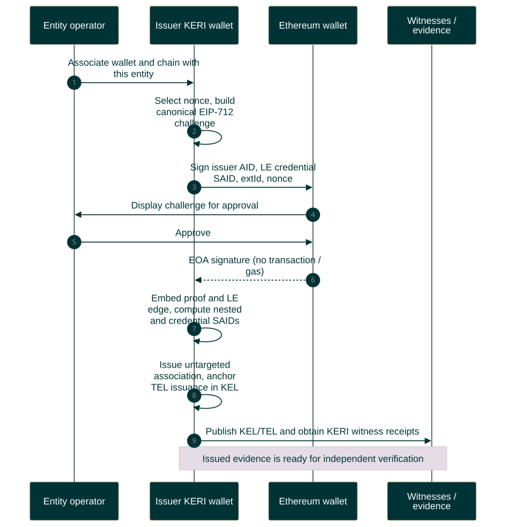

# EOA association creation

Association issuance workflow. A legal entity operator uses an Ethereum wallet and a vLEI wallet controlling the entity's AID. The entity already holds a valid LE vLEI. This four-actor ceremony embeds the Ethereum proof before issuing the association ACDC.

[Open the rendered chart](association-creation-sequence.svg). Dark teal participants, lavender notes and green completion bands follow the methodology's sequence diagram.



<details>
<summary>Editable Mermaid source</summary>

Render exports on an opaque white canvas to preserve this palette in light and dark viewers. Keep bottom participant labels enabled so lifelines span the full sequence.

```text
%%{init: {"theme":"base","fontFamily":"Arial, sans-serif","themeCSS":"text { font-family: Arial, sans-serif !important; }","themeVariables":{"fontFamily":"Arial, sans-serif","primaryColor":"#003336","primaryTextColor":"#FFFFFF","primaryBorderColor":"#003336","lineColor":"#6A7B7F","actorBkg":"#003336","actorBorder":"#003336","actorTextColor":"#FFFFFF","actorLineColor":"#6A7B7F","signalColor":"#003336","signalTextColor":"#003336","labelBoxBkgColor":"#DFFBC0","labelBoxBorderColor":"#6A7B7F","labelTextColor":"#003336","loopTextColor":"#003336","noteBkgColor":"#E5DCE6","noteBorderColor":"#6A7B7F","noteTextColor":"#003336","sequenceNumberColor":"#FFFFFF"},"sequence":{"mirrorActors":true,"actorMargin":28,"width":155,"height":55,"messageMargin":24,"noteMargin":12,"diagramMarginX":20,"diagramMarginY":20,"wrap":false,"actorFontFamily":"Arial","messageFontFamily":"Arial","noteFontFamily":"Arial"}}}%%
sequenceDiagram
    autonumber
    participant U as Entity operator
    participant VW as vLEI wallet<br/>Entity AID and registry
    participant EW as Ethereum wallet<br/>EOA key
    participant W as KERI evidence<br/>Witnesses and sources

    rect rgb(246, 243, 247)
        Note over U,EW: Create the association — two distinct key systems
        U->>VW: Associate my EOA with this entity<br/>Select address and chain
        VW->>VW: Normalize extId, mint single-use nonce<br/>Build EIP-712 challenge
        Note over VW,EW: Signed fields: issuer AID, LE vLEI SAID,<br/>extId and nonce. Domain chainId matches<br/>eip155:chainId:address
        VW->>EW: Request off-chain challenge signature
        EW->>U: Display entity, account, chain and nonce
        U->>EW: Review and approve
        EW-->>VW: EOA signature — no transaction or gas
        VW->>VW: Verify signature, consume nonce<br/>Embed a.proof, set u and e.le, compute SAID last
        Note over VW: Untargeted ACDC: no issuee<br/>LEI comes from the LE vLEI edge
        VW->>VW: Issue association in own TEL<br/>Anchor issuance in signed KEL
        VW->>W: Publish KEL anchor and supporting TEL evidence
        W-->>VW: Witness receipts for KEL anchor
    end
    rect rgb(223, 251, 192)
        Note over VW,W: Association issued — SAID commits to the embedded proof<br/>Ready for presentation — independent verification follows
    end
```

</details>

The result is an issued association with an embedded Ethereum proof and supporting KERI evidence. It is ready for [independent verification and webhook delivery](association-verification-sequence.md); issuance alone is not a verifier decision or an on-chain endorsement.

EOA key control is proven at ceremony time. Account-state queries cannot detect a sold or stolen private key; credential revocation and a relying party's re-association/recency policy address that limit. Optional on-chain publication of the association pointer is omitted: it is not needed to complete or verify the association.

For the broader application, see [verified associations and stablecoin transfers](stablecoin-end-to-end-sequence.md).

Sources: `eoa-profile.docx`, `methodology.docx` (original color theme), and [current EIP-712 profile](https://github.com/GLEIF-IT/vlei-oracle/blob/7d82d04cd444cb21e1da1e6ec0408cc40105d4f4/protocol/external-association-v1/eoa-v1/README.md). The documents permit other challenge carriers; this design selects EIP-712 from our agreed plan.
