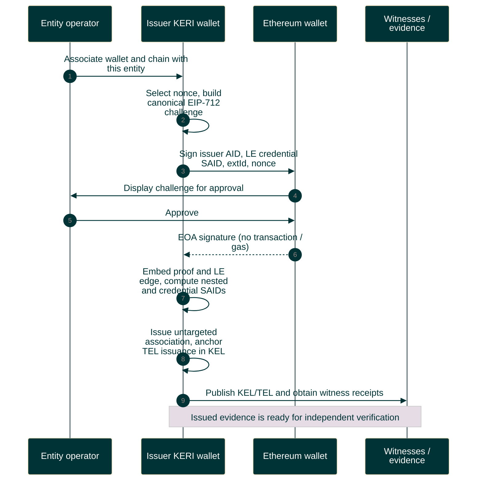

# EOA association creation

The issuer controls its entity AID and holds the referenced LE vLEI. Issuance and Verifier acceptance are separate operations.

Editable Mermaid source

The [EOA profile](../../../protocol/external-association-v1/eoa-v1/README.md) owns the signed fields. No issuer nonce ledger is part of this service model. Verifier consumes the exact issuer/nonce on application acceptance. Continue with [verification](association-verification-sequence.md).
