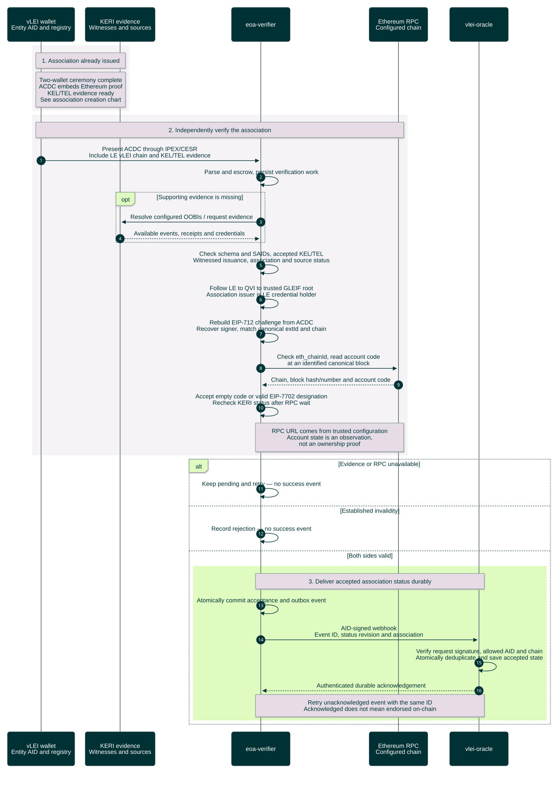
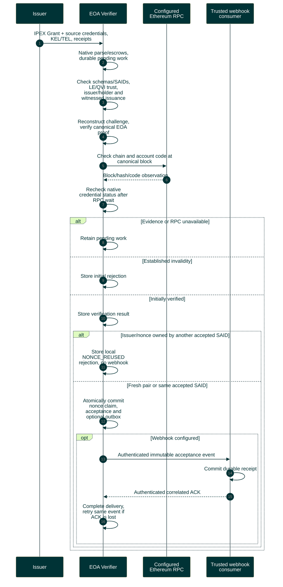

# Association verification and acceptance

Verifier independently checks issued evidence before acceptance. The configured consumer may be Oracle or another service.

Editable Mermaid source

[Verifier API](../../../protocol/verifier-api-v1/README.md) owns events, signatures, ACKs and stored status. An ACK is not downstream selection or endorsement. [Oracle qualification](https://github.com/GLEIF-IT/vlei-oracle/blob/main/docs/two-service-qualification.md) owns the full-system scenario.
