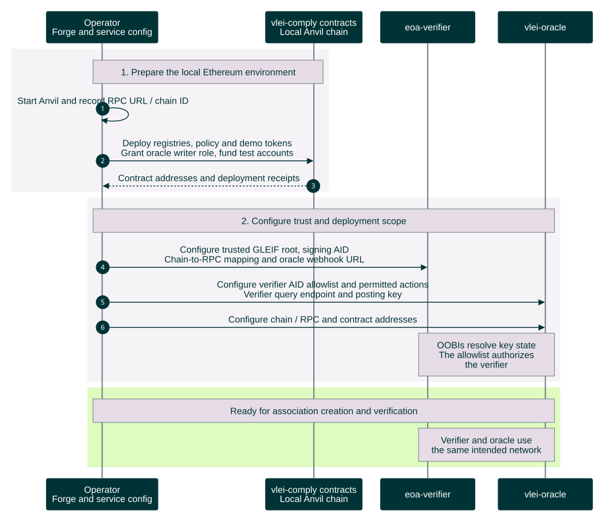

# Local demo setup

Local deployment workflow. Prepare the local chain, contracts and service configuration before either party starts the association workflow. This chart assumes the verifier has a signing AID and the oracle has a dedicated Ethereum posting key.

[Open the rendered chart](local-setup-sequence.svg) · [Workflow guide](../../README.md)



<details>
<summary>Editable Mermaid source</summary>

Render exports on an opaque white canvas to preserve this palette in light and dark viewers. Keep bottom participant labels enabled so lifelines span the full sequence.

```text
%%{init: {"theme":"base","fontFamily":"Arial, sans-serif","themeCSS":"text { font-family: Arial, sans-serif !important; }","themeVariables":{"fontFamily":"Arial, sans-serif","primaryColor":"#003336","primaryTextColor":"#FFFFFF","primaryBorderColor":"#003336","lineColor":"#6A7B7F","actorBkg":"#003336","actorBorder":"#003336","actorTextColor":"#FFFFFF","actorLineColor":"#6A7B7F","signalColor":"#003336","signalTextColor":"#003336","labelBoxBkgColor":"#DFFBC0","labelBoxBorderColor":"#6A7B7F","labelTextColor":"#003336","loopTextColor":"#003336","noteBkgColor":"#E5DCE6","noteBorderColor":"#6A7B7F","noteTextColor":"#003336","sequenceNumberColor":"#FFFFFF"},"sequence":{"mirrorActors":true,"actorMargin":32,"width":165,"height":55,"messageMargin":25,"noteMargin":12,"diagramMarginX":20,"diagramMarginY":20,"wrap":false,"actorFontFamily":"Arial","messageFontFamily":"Arial","noteFontFamily":"Arial"}}}%%
sequenceDiagram
    autonumber
    participant S as Operator<br/>Forge and service config
    participant C as vlei-comply contracts<br/>Local Anvil chain
    participant V as eoa-verifier
    participant O as vlei-oracle

    rect rgb(246, 243, 247)
        Note over S,C: 1. Prepare the local Ethereum environment
        S->>S: Start Anvil and record RPC URL / chain ID
        S->>C: Deploy registries, policy and demo tokens<br/>Grant oracle writer role, fund test accounts
        C-->>S: Contract addresses and deployment receipts
    end
    rect rgb(246, 243, 247)
        Note over S,O: 2. Configure trust and deployment scope
        S->>V: Configure trusted GLEIF root, signing AID<br/>Chain-to-RPC mapping and oracle webhook URL
        S->>O: Configure verifier AID allowlist and permitted actions<br/>Verifier query endpoint and posting key
        S->>O: Configure chain / RPC and contract addresses
        Note over V,O: OOBIs resolve key state<br/>The allowlist authorizes<br/>the verifier
    end
    rect rgb(223, 251, 192)
        Note over S,O: Ready for association creation and verification
        Note over V,O: Verifier and oracle use<br/>the same intended network
    end
```

</details>

The wallet ceremony must select that network's chain ID. The verifier checks `eth_chainId` against the association's `extId`; the oracle checks the association against its deployment. RPC URLs may differ, but a matching chain ID alone does not distinguish two separate local Anvil instances or a reset chain. Configure both services against the intended instance and its deployed contracts.

Both parties need their Ethereum wallets and valid LE vLEIs before [association creation](association-creation-sequence.md). Continue with the [end-to-end flow](stablecoin-end-to-end-sequence.md) after setup. Forge handles deployment and test preparation; it does not participate in each transfer.

Sources: `eoa-profile.docx`, `methodology.docx` (original color theme), [wallet association policy](https://github.com/GLEIF-IT/vlei-comply/blob/f61846512bbc75255b82c25b1c4ac71bc2127c57/src/policies/VLEIWalletAssociationPolicy.sol), [oracle registry](https://github.com/GLEIF-IT/vlei-comply/blob/f61846512bbc75255b82c25b1c4ac71bc2127c57/src/attestation/VLEIOracleRegistry.sol), and [wrapped token](https://github.com/GLEIF-IT/vlei-comply/blob/f61846512bbc75255b82c25b1c4ac71bc2127c57/src/wrappers/wUSDC.sol). The linked comply revision provides the two-service launcher; public stored status and authenticated delivery are implemented.
