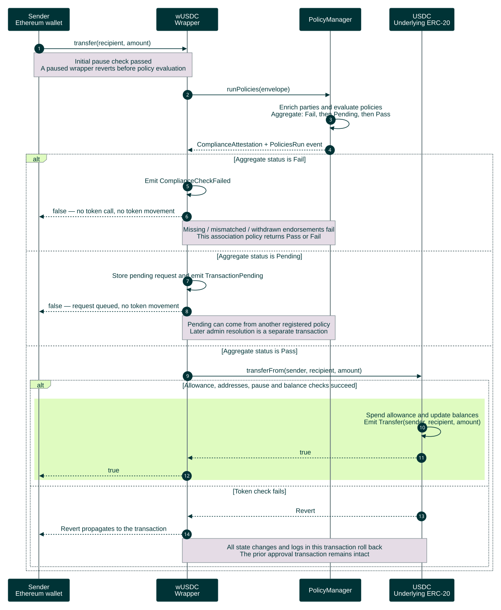

# On-chain transfer outcomes and failures

Companion to the [successful on-chain transfer](on-chain-transfer-sequence.md), grounded in `vlei-comply` commit `6220cd7`. This chart starts after the wrapper's initial pause check and condenses identity enrichment and policy evaluation into `runPolicies`.

[Open the rendered chart](on-chain-transfer-outcomes-sequence.svg) · [Workflow guide](../../README.md)



<details>
<summary>Editable Mermaid source</summary>

Render exports on an opaque white canvas to preserve this palette in light and dark viewers. Keep bottom participant labels enabled so lifelines span the full sequence.

```text
%%{init: {"theme":"base","fontFamily":"Arial, sans-serif","themeCSS":"text { font-family: Arial, sans-serif !important; }","themeVariables":{"fontFamily":"Arial, sans-serif","primaryColor":"#003336","primaryTextColor":"#FFFFFF","primaryBorderColor":"#003336","lineColor":"#6A7B7F","actorBkg":"#003336","actorBorder":"#003336","actorTextColor":"#FFFFFF","actorLineColor":"#6A7B7F","signalColor":"#003336","signalTextColor":"#003336","labelBoxBkgColor":"#DFFBC0","labelBoxBorderColor":"#6A7B7F","labelTextColor":"#003336","loopTextColor":"#003336","noteBkgColor":"#E5DCE6","noteBorderColor":"#6A7B7F","noteTextColor":"#003336","sequenceNumberColor":"#FFFFFF"},"sequence":{"mirrorActors":true,"actorMargin":24,"width":150,"height":55,"messageMargin":25,"noteMargin":12,"diagramMarginX":20,"diagramMarginY":20,"wrap":false,"actorFontFamily":"Arial","messageFontFamily":"Arial","noteFontFamily":"Arial"}}}%%
sequenceDiagram
    autonumber
    participant S as Sender<br/>Ethereum wallet
    participant W as wUSDC<br/>Wrapper
    participant M as PolicyManager
    participant T as USDC<br/>Underlying ERC-20

    S->>W: transfer(recipient, amount)
    Note over S,W: Initial pause check passed<br/>A paused wrapper reverts before policy evaluation
    W->>M: runPolicies(envelope)
    M->>M: Enrich parties and evaluate policies<br/>Aggregate: Fail, then Pending, then Pass
    M-->>W: ComplianceAttestation + PoliciesRun event

    alt Aggregate status is Fail
        W->>W: Emit ComplianceCheckFailed
        W-->>S: false — no token call, no token movement
        Note over W,M: Missing / mismatched / withdrawn endorsements fail<br/>This association policy returns Pass or Fail
    else Aggregate status is Pending
        W->>W: Store pending request and emit TransactionPending
        W-->>S: false — request queued, no token movement
        Note over W,M: Pending can come from another registered policy<br/>Later admin resolution is a separate transaction
    else Aggregate status is Pass
        W->>T: transferFrom(sender, recipient, amount)
        alt Allowance, addresses, pause and balance checks succeed
            rect rgb(223, 251, 192)
                T->>T: Spend allowance and update balances<br/>Emit Transfer(sender, recipient, amount)
                T-->>W: true
                W-->>S: true
            end
        else Token check fails
            T-->>W: Revert
            W-->>S: Revert propagates to the transaction
            Note over W,T: All state changes and logs in this transaction roll back<br/>The prior approval transaction remains intact
        end
    end
```

</details>

A missing identity mapping, zero wallet/identity, mismatched identity, or absent/withdrawn exact-wallet endorsement makes the association policy fail; it stops at the first failing customer. Registering an identity or endorsing another wallet of the same entity is insufficient. Across registered policies, Fail overrides Pending, and Pending overrides Pass.

Fail/Pending return `false` without reverting, so a successful transaction receipt can still mean **no transfer**. These paths retain their diagnostic event and, for Pending, the queue record. This association policy itself never returns Pending. On the successful path, verify the underlying USDC `Transfer` event and balances.

The wrapper checks `AdminControls.isPaused()` before evaluation; the token also checks pause during its update. Insufficient allowance/balance or invalid sender/recipient addresses revert the token call. An uncaught policy or contract error also reverts the transaction; identity-enrichment read failures are caught, and a missing wallet identity then fails the association policy. A reverted transaction does not undo a previously confirmed approval. Administrative resolution of queued requests is outside this initial `transfer` flow.

Sources: [wrapper](https://github.com/GLEIF-IT/vlei-comply/blob/f61846512bbc75255b82c25b1c4ac71bc2127c57/src/wrappers/wUSDC.sol), [policy manager](https://github.com/GLEIF-IT/vlei-comply/blob/f61846512bbc75255b82c25b1c4ac71bc2127c57/src/policy/PolicyManager.sol), [association policy](https://github.com/GLEIF-IT/vlei-comply/blob/f61846512bbc75255b82c25b1c4ac71bc2127c57/src/policies/VLEIWalletAssociationPolicy.sol), [demo USDC](https://github.com/GLEIF-IT/vlei-comply/blob/f61846512bbc75255b82c25b1c4ac71bc2127c57/src/assets/USDC.sol), [compliance tests](https://github.com/GLEIF-IT/vlei-comply/blob/f61846512bbc75255b82c25b1c4ac71bc2127c57/test/VLEIOracleComplianceTest.t.sol), and [pending-request tests](https://github.com/GLEIF-IT/vlei-comply/blob/f61846512bbc75255b82c25b1c4ac71bc2127c57/test/ComplianceTest.t.sol).
