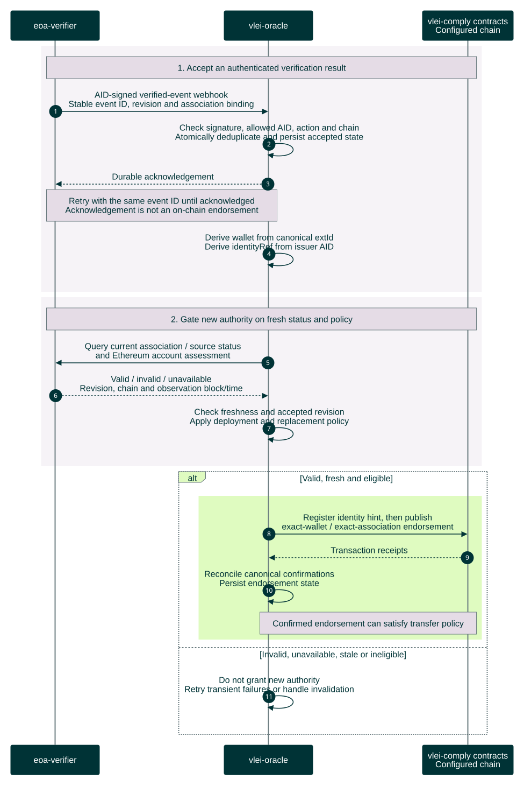

# Oracle acceptance and on-chain endorsement

Future workflow beyond PR #2 for one accepted, verified association. The verifier has completed cryptographic verification. The oracle now decides whether that result may grant authority in its configured deployment.

[Open the rendered chart](oracle-endorsement-sequence.svg) · [Workflow guide](../../README.md)



<details>
<summary>Editable Mermaid source</summary>

Render exports on an opaque white canvas to preserve this palette in light and dark viewers. Keep bottom participant labels enabled so lifelines span the full sequence.

```text
%%{init: {"theme":"base","fontFamily":"Arial, sans-serif","themeCSS":"text { font-family: Arial, sans-serif !important; }","themeVariables":{"fontFamily":"Arial, sans-serif","primaryColor":"#003336","primaryTextColor":"#FFFFFF","primaryBorderColor":"#003336","lineColor":"#6A7B7F","actorBkg":"#003336","actorBorder":"#003336","actorTextColor":"#FFFFFF","actorLineColor":"#6A7B7F","signalColor":"#003336","signalTextColor":"#003336","labelBoxBkgColor":"#DFFBC0","labelBoxBorderColor":"#6A7B7F","labelTextColor":"#003336","loopTextColor":"#003336","noteBkgColor":"#E5DCE6","noteBorderColor":"#6A7B7F","noteTextColor":"#003336","sequenceNumberColor":"#FFFFFF"},"sequence":{"mirrorActors":true,"actorMargin":32,"width":165,"height":55,"messageMargin":25,"noteMargin":12,"diagramMarginX":20,"diagramMarginY":20,"wrap":false,"actorFontFamily":"Arial","messageFontFamily":"Arial","noteFontFamily":"Arial"}}}%%
sequenceDiagram
    autonumber
    participant V as eoa-verifier
    participant O as vlei-oracle
    participant C as vlei-comply contracts<br/>Configured chain

    rect rgb(246, 243, 247)
        Note over V,C: 1. Accept an authenticated verification result
        V->>O: AID-signed verified-event webhook<br/>Stable event ID, revision and association
        O->>O: Check signature, allowed AID, action and chain<br/>Atomically deduplicate and persist accepted state
        O-->>V: Durable acknowledgement
        Note over V,O: Retry with the same event ID until acknowledged<br/>Acknowledgement is not an on-chain endorsement
        O->>O: Derive wallet from canonical extId<br/>Derive identityRef from issuer AID
    end
    rect rgb(246, 243, 247)
        Note over V,C: 2. Select the accepted association
        O->>O: Check durable revocation and replacement state<br/>Apply configured chain and ownership policy
        Note over V,O: Trust authenticated verifier status<br/>No new verification or account query before posting
    end
    alt Issued, verified and selected
        rect rgb(223, 251, 192)
            O->>C: Register identity hint, then publish<br/>exact-wallet / exact-association endorsement
            C-->>O: Transaction receipts
            O->>O: Check receipts and contract state<br/>Persist endorsement state
            Note over O,C: Confirmed endorsement can satisfy transfer policy
        end
    else Revoked, superseded or ineligible
        O->>O: Do not grant new authority<br/>Record the reason without publishing
    end
```

</details>

The oracle derives `wallet` from `extId` and `identityRef = keccak256(issuerAid)`, and checks these against the accepted association and deployment scope. It authenticates the verifier's result without repeating KERI or EIP-712 association-proof verification. Unauthenticated or out-of-scope events do not enter accepted state; duplicates do not create duplicate effects.

Use existing contract operations and ordinary submission/result handling. Report failures accurately: submission alone is not confirmed contract state. Retrying an accepted association checks durable revocation/replacement state without repeating verification. No new nonce-reconciliation, cancellation or reorg-recovery subsystem is required. See [association revocation](revocation-status-sequence.md) and [stablecoin transfers](stablecoin-end-to-end-sequence.md).

Sources: [EOA profile](/Users/kbull/gleif/projects/vlei-external-association/initial-docs-from-kevin/eoa-profile.docx), [methodology and original color theme](/Users/kbull/gleif/projects/vlei-external-association/initial-docs-from-kevin/methodology.docx), [wallet association policy](../../../../gl1/vlei-comply/src/policies/VLEIWalletAssociationPolicy.sol), [oracle registry](../../../../gl1/vlei-comply/src/attestation/VLEIOracleRegistry.sol), and [wrapped token](../../../../gl1/vlei-comply/src/wrappers/wUSDC.sol). Contract behavior is grounded in local `vlei-comply` commit `6220cd7`; the separate verifier and webhook boundary are planned.
