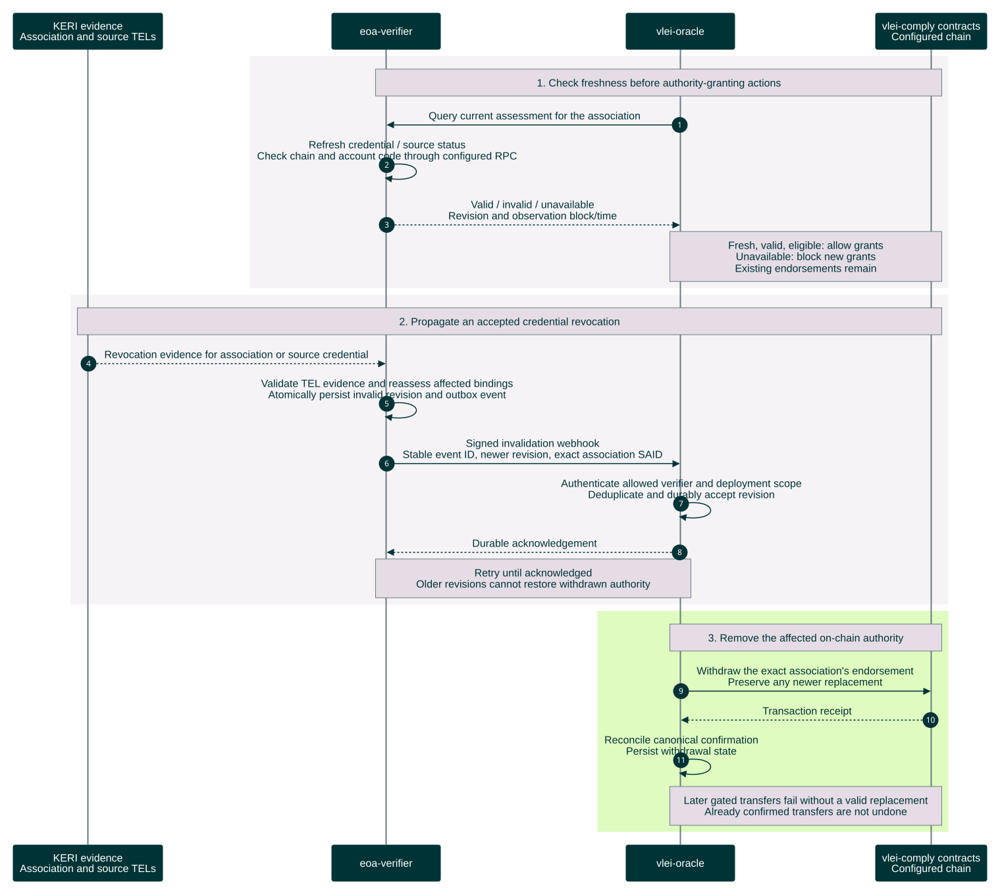

# Revocation and continuing status

An accepted association remains valid until its own ACDC is verifiably revoked or it is superseded. Time and service outages do not invalidate it.

[Open the rendered chart](revocation-status-sequence.svg) · [Workflow guide](../../README.md)



<details>
<summary>Editable Mermaid source</summary>

Render exports on an opaque white canvas to preserve this palette in light and dark viewers. Keep bottom participant labels enabled so lifelines span the full sequence.

```text
%%{init: {"theme":"base","fontFamily":"Arial, sans-serif","themeCSS":"text { font-family: Arial, sans-serif !important; }","themeVariables":{"fontFamily":"Arial, sans-serif","primaryColor":"#003336","primaryTextColor":"#FFFFFF","primaryBorderColor":"#003336","lineColor":"#6A7B7F","actorBkg":"#003336","actorBorder":"#003336","actorTextColor":"#FFFFFF","actorLineColor":"#6A7B7F","signalColor":"#003336","signalTextColor":"#003336","labelBoxBkgColor":"#DFFBC0","labelBoxBorderColor":"#6A7B7F","labelTextColor":"#003336","loopTextColor":"#003336","noteBkgColor":"#E5DCE6","noteBorderColor":"#6A7B7F","noteTextColor":"#003336","sequenceNumberColor":"#FFFFFF"},"sequence":{"mirrorActors":true,"actorMargin":32,"width":165,"height":55,"messageMargin":25,"noteMargin":12,"diagramMarginX":20,"diagramMarginY":20,"wrap":false,"actorFontFamily":"Arial","messageFontFamily":"Arial","noteFontFamily":"Arial"}}}%%
sequenceDiagram
    autonumber
    participant K as KERI evidence<br/>Association TEL and issuer KEL
    participant V as eoa-verifier
    participant O as vlei-oracle
    participant C as vlei-comply contracts<br/>Configured chain

    Note over V,O: Accepted status persists indefinitely<br/>No periodic account or source-chain checks
    rect rgb(246, 243, 247)
        Note over K,C: 1. Accept verified association revocation evidence
        K-->>V: IPEX delivery with supporting TEL/KEL evidence
        V->>V: KERIpy parser and escrows accept revocation<br/>Grant or credential bytes alone are not proof
        V->>V: Durably retire this association<br/>Commit a separate status update and outbox event
        V->>O: AID-signed revocation webhook<br/>Immutable event ID, status revision and exact association SAID
        O->>O: Authenticate, deduplicate and persist revoked status
        O-->>V: Authenticated durable acknowledgement
        Note over V,O: Retry the same event until acknowledged<br/>Preserve revocation across restart and replay
    end
    rect rgb(223, 251, 192)
        Note over O,C: 2. Remove the affected on-chain authority
        O->>C: Withdraw the exact association's endorsement<br/>Preserve any newer replacement
        C-->>O: Transaction receipt
        O->>O: Check receipt and contract state<br/>Persist withdrawal state
        Note over O,C: Later gated transfers fail without a valid replacement<br/>Already confirmed transfers are not undone
    end
```

</details>

Only KERIpy verification of the association's revocation triggers retirement; missing evidence or an outage is not revocation. A delayed revocation of an older association must not withdraw its replacement. Continuing LE/QVI monitoring and account-code reassessment are outside this build.

The public GET-by-SAID route reads stored status and the last-known initial account observation without refresh or RPC. Its timestamps and block identifiers are informational. Webhook delivery remains authenticated independently of this unsigned public read.

Revocation has evidence-delivery, acknowledgement and transaction latency. Until withdrawal is confirmed, a mapping can remain active; contracts provide no automatic expiry. Use ordinary transaction results, without a new recovery subsystem.

See [oracle endorsement](oracle-endorsement-sequence.md) for the granting path and the [end-to-end flow](stablecoin-end-to-end-sequence.md) for transfers.

Sources: `eoa-profile.docx`, `methodology.docx` (original color theme), [wallet association policy](https://github.com/GLEIF-IT/vlei-comply/blob/f61846512bbc75255b82c25b1c4ac71bc2127c57/src/policies/VLEIWalletAssociationPolicy.sol), [oracle registry](https://github.com/GLEIF-IT/vlei-comply/blob/f61846512bbc75255b82c25b1c4ac71bc2127c57/src/attestation/VLEIOracleRegistry.sol), and [wrapped token](https://github.com/GLEIF-IT/vlei-comply/blob/f61846512bbc75255b82c25b1c4ac71bc2127c57/src/wrappers/wUSDC.sol). Contract behavior is grounded in the linked comply revision; KERIpy retirement, authenticated delivery and stored status are implemented.
