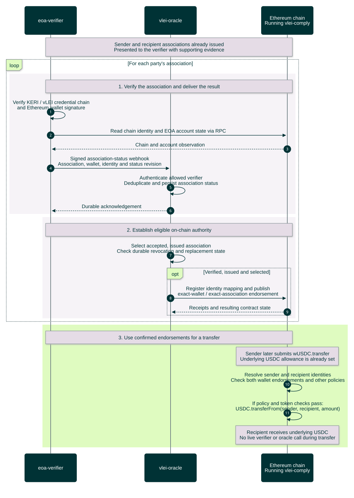

# From issued associations to compliant transfers

Proposed high-level flow across **eoa-verifier**, **vlei-oracle**, and the **Ethereum chain running vlei-comply**. Sender and recipient have already [created their associations](association-creation-sequence.md), and [deployment setup](local-setup-sequence.md) is complete. The verifier's RPC and the oracle's deployment target the same intended network.

[Open the rendered chart](service-overview-sequence.svg) · [Workflow guide](../../README.md)



<details>
<summary>Editable Mermaid source</summary>

Render exports on an opaque white canvas to preserve this palette in light and dark viewers. Keep bottom participant labels enabled so lifelines span the full sequence.

```text
%%{init: {"theme":"base","fontFamily":"Arial, sans-serif","themeCSS":"text { font-family: Arial, sans-serif !important; }","themeVariables":{"fontFamily":"Arial, sans-serif","primaryColor":"#003336","primaryTextColor":"#FFFFFF","primaryBorderColor":"#003336","lineColor":"#6A7B7F","actorBkg":"#003336","actorBorder":"#003336","actorTextColor":"#FFFFFF","actorLineColor":"#6A7B7F","signalColor":"#003336","signalTextColor":"#003336","labelBoxBkgColor":"#DFFBC0","labelBoxBorderColor":"#6A7B7F","labelTextColor":"#003336","loopTextColor":"#003336","noteBkgColor":"#E5DCE6","noteBorderColor":"#6A7B7F","noteTextColor":"#003336","sequenceNumberColor":"#FFFFFF"},"sequence":{"mirrorActors":true,"actorMargin":32,"width":165,"height":55,"messageMargin":25,"noteMargin":12,"diagramMarginX":20,"diagramMarginY":20,"wrap":false,"actorFontFamily":"Arial","messageFontFamily":"Arial","noteFontFamily":"Arial"}}}%%
sequenceDiagram
    autonumber
    participant V as eoa-verifier
    participant O as vlei-oracle
    participant C as Ethereum chain<br/>Running vlei-comply

    Note over V,C: Sender and recipient associations already issued<br/>Presented to the verifier with supporting evidence
    loop For each party's association
        rect rgb(246, 243, 247)
            Note over V,C: 1. Verify the binding and deliver the result
            V->>V: Verify KERI / vLEI credential chain<br/>and Ethereum wallet signature
            V->>C: Read chain identity and EOA account state via RPC
            C-->>V: Chain and account observation
            V->>O: Signed verified-result webhook<br/>Association, wallet, identity and revision
            O->>O: Authenticate allowed verifier<br/>Deduplicate and persist accepted result
            O-->>V: Durable acknowledgement
        end
        rect rgb(246, 243, 247)
            Note over V,C: 2. Establish eligible on-chain authority
            O->>V: Check fresh credential and account status
            V-->>O: Valid / invalid / unavailable<br/>Revision and observation time/block
            opt Fresh, valid and permitted by oracle policy
                O->>C: Register identity mapping and publish<br/>exact-wallet / exact-association endorsement
                C-->>O: Receipts — oracle reconciles confirmations
            end
        end
    end
    rect rgb(223, 251, 192)
        Note over V,C: 3. Use confirmed endorsements for a transfer
        Note over C: Sender later submits wUSDC.transfer<br/>Underlying USDC allowance is already set
        C->>C: Resolve sender and recipient identities<br/>Check both wallet endorsements and other policies
        C->>C: If policy and token checks pass:<br/>USDC.transferFrom(sender, recipient, amount)
        Note over C: Recipient receives underlying USDC<br/>No live verifier or oracle call during transfer
    end
```

</details>

The verifier establishes the cryptographic binding and observes current status. The oracle authenticates that result, applies deployment policy and manages the endorsement transactions. The contracts consume the posted endorsements. Wallet presentation and the sender's transfer transaction are shown as boundary notes to keep the chart to these three participants; the oracle does not initiate the user's transfer.

Only a valid verification produces the success webhook. Missing evidence stays pending; invalid evidence is rejected. Delivery retries, current-status reassessment and transaction recovery are condensed. Both parties need eligible endorsements for the transfer; a successful webhook acknowledgement alone does not grant on-chain authority.

Details: [verification](association-verification-sequence.md), [oracle endorsement](oracle-endorsement-sequence.md), and [on-chain transfer](on-chain-transfer-sequence.md). See [revocation/status maintenance](revocation-status-sequence.md) for later withdrawal and outage limits, and [transfer outcomes](on-chain-transfer-outcomes-sequence.md) for policy rejection, pending requests and token reverts. This overview follows the proposed extraction design and the documented `vlei-comply` behavior at commit `6220cd7`.
