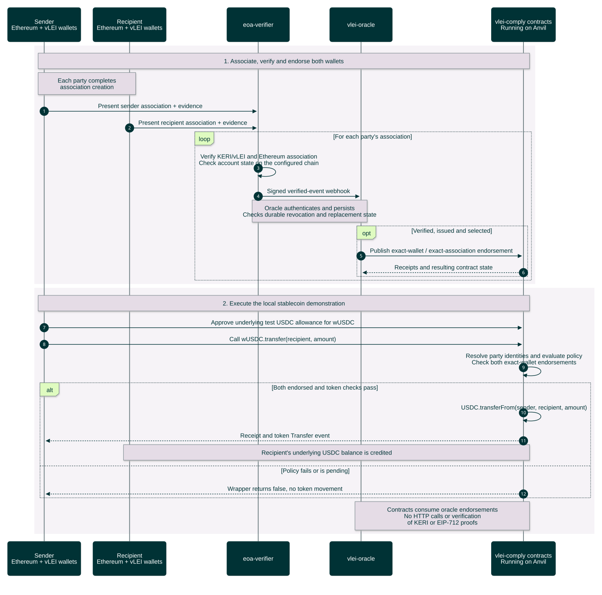

# Verified wallet associations and stablecoin transfers

Intended local end-to-end workflow beyond PR #2 after [local setup](local-setup-sequence.md). Both parties create an association, the verifier checks it, and the oracle establishes eligible endorsements before the policy-controlled transfer.

[Open the rendered chart](stablecoin-end-to-end-sequence.svg) · [Workflow guide](../../README.md)



<details>
<summary>Editable Mermaid source</summary>

Render exports on an opaque white canvas to preserve this palette in light and dark viewers. Keep bottom participant labels enabled so lifelines span the full sequence.

```text
%%{init: {"theme":"base","fontFamily":"Arial, sans-serif","themeCSS":"text { font-family: Arial, sans-serif !important; }","themeVariables":{"fontFamily":"Arial, sans-serif","primaryColor":"#003336","primaryTextColor":"#FFFFFF","primaryBorderColor":"#003336","lineColor":"#6A7B7F","actorBkg":"#003336","actorBorder":"#003336","actorTextColor":"#FFFFFF","actorLineColor":"#6A7B7F","signalColor":"#003336","signalTextColor":"#003336","labelBoxBkgColor":"#DFFBC0","labelBoxBorderColor":"#6A7B7F","labelTextColor":"#003336","loopTextColor":"#003336","noteBkgColor":"#E5DCE6","noteBorderColor":"#6A7B7F","noteTextColor":"#003336","sequenceNumberColor":"#FFFFFF"},"sequence":{"mirrorActors":true,"actorMargin":32,"width":165,"height":55,"messageMargin":25,"noteMargin":12,"diagramMarginX":20,"diagramMarginY":20,"wrap":false,"actorFontFamily":"Arial","messageFontFamily":"Arial","noteFontFamily":"Arial"}}}%%
sequenceDiagram
    autonumber
    participant A as Sender<br/>Ethereum + vLEI wallets
    participant B as Recipient<br/>Ethereum + vLEI wallets
    participant V as eoa-verifier
    participant O as vlei-oracle
    participant C as vlei-comply contracts<br/>Running on Anvil

    rect rgb(246, 243, 247)
        Note over A,C: 1. Associate, verify and endorse both wallets
        Note over A,B: Each party completes<br/>association creation
        A->>V: Present sender association + evidence
        B->>V: Present recipient association + evidence
        loop For each party's association
            V->>V: Verify KERI/vLEI and Ethereum association<br/>Check account state on the configured chain
            V->>O: Signed verified-event webhook
            Note over V,O: Oracle authenticates and persists<br/>Checks durable revocation and replacement state
            opt Verified, issued and selected
                O->>C: Publish exact-wallet / exact-association endorsement
                C-->>O: Receipts and resulting contract state
            end
        end
    end

    rect rgb(246, 243, 247)
        Note over A,C: 2. Execute the local stablecoin demonstration
        A->>C: Approve underlying test USDC allowance for wUSDC
        A->>C: Call wUSDC.transfer(recipient, amount)
        C->>C: Resolve party identities and evaluate policy<br/>Check both exact-wallet endorsements
        alt Both endorsed and token checks pass
            C->>C: USDC.transferFrom(sender, recipient, amount)
            C-->>A: Receipt and token Transfer event
            Note over B,C: Recipient's underlying USDC balance is credited
        else Policy fails or is pending
            C-->>A: Wrapper returns false, no token movement
        end
        Note over O,C: Contracts consume oracle endorsements<br/>No HTTP calls or verification<br/>of KERI or EIP-712 proofs
    end
```

</details>

Detailed charts: [association creation](association-creation-sequence.md) → [verification and webhook delivery](association-verification-sequence.md) → [oracle endorsement](oracle-endorsement-sequence.md). The transfer internals are detailed in [on-chain compliance and transfer](on-chain-transfer-sequence.md). Continuing authority is covered separately in [revocation and status maintenance](revocation-status-sequence.md).

The transfer path is the local **policy-controlled stablecoin wrapper** (`wUSDC`), with test balances prepared in setup; a direct transfer of the underlying mock USDC does not enforce this policy. Check the underlying `Transfer` event and balances: a successful receipt alone does not prove a transfer, because a policy failure can return `false`.

Existing endorsements can outlive an evidence outage or a revocation still propagating to the chain. See the status-maintenance chart for these limits; the transfer itself does not perform a live verifier query.

Sources: [EOA profile](/Users/kbull/gleif/projects/vlei-external-association/initial-docs-from-kevin/eoa-profile.docx), [methodology and original color theme](/Users/kbull/gleif/projects/vlei-external-association/initial-docs-from-kevin/methodology.docx), [wallet association policy](../../../../gl1/vlei-comply/src/policies/VLEIWalletAssociationPolicy.sol), [oracle registry](../../../../gl1/vlei-comply/src/attestation/VLEIOracleRegistry.sol), and [wrapped token](../../../../gl1/vlei-comply/src/wrappers/wUSDC.sol). Contract behavior is grounded in local `vlei-comply` commit `6220cd7`; the separate verifier and webhook boundary are planned.
