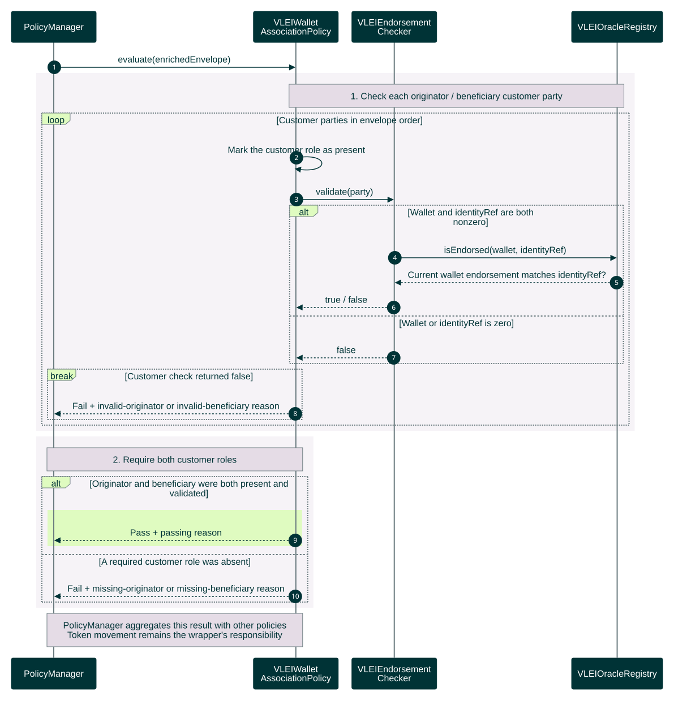

# Exact-wallet endorsement evaluation

The policy detail behind [on-chain compliance and USDC transfer](on-chain-transfer-sequence.md), grounded in `vlei-comply` commit `6220cd7`. Input is an enriched transaction envelope; output is **Pass or Fail with a reason code**. This read-only evaluation consumes existing endorsements and does not publish new authority.

[Open the rendered chart](wallet-endorsement-evaluation-sequence.svg) · [Workflow guide](../../README.md)



<details>
<summary>Editable Mermaid source</summary>

Render exports on an opaque white canvas to preserve this palette in light and dark viewers. Keep bottom participant labels enabled so lifelines span the full sequence.

```text
%%{init: {"theme":"base","fontFamily":"Arial, sans-serif","themeCSS":"text { font-family: Arial, sans-serif !important; }","themeVariables":{"fontFamily":"Arial, sans-serif","primaryColor":"#003336","primaryTextColor":"#FFFFFF","primaryBorderColor":"#003336","lineColor":"#6A7B7F","actorBkg":"#003336","actorBorder":"#003336","actorTextColor":"#FFFFFF","actorLineColor":"#6A7B7F","signalColor":"#003336","signalTextColor":"#003336","labelBoxBkgColor":"#DFFBC0","labelBoxBorderColor":"#6A7B7F","labelTextColor":"#003336","loopTextColor":"#003336","noteBkgColor":"#E5DCE6","noteBorderColor":"#6A7B7F","noteTextColor":"#003336","sequenceNumberColor":"#FFFFFF"},"sequence":{"mirrorActors":true,"actorMargin":24,"width":150,"height":55,"messageMargin":25,"noteMargin":12,"diagramMarginX":20,"diagramMarginY":20,"wrap":false,"actorFontFamily":"Arial","messageFontFamily":"Arial","noteFontFamily":"Arial"}}}%%
sequenceDiagram
    autonumber
    participant M as PolicyManager
    participant P as VLEIWallet<br/>AssociationPolicy
    participant E as VLEIEndorsement<br/>Checker
    participant R as VLEIOracleRegistry

    M->>P: evaluate(enrichedEnvelope)
    rect rgb(246, 243, 247)
        Note over P,R: 1. Check each originator / beneficiary customer party
        loop Customer parties in envelope order
            P->>P: Mark the customer role as present
            P->>E: validate(party)
            alt Wallet and identityRef are both nonzero
                E->>R: isEndorsed(wallet, identityRef)
                R-->>E: Current wallet endorsement matches identityRef?
                E-->>P: true / false
            else Wallet or identityRef is zero
                E-->>P: false
            end
            break Customer check returned false
                P-->>M: Fail + invalid-originator or invalid-beneficiary reason
            end
        end
    end
    rect rgb(246, 243, 247)
        Note over M,P: 2. Require both customer roles
        alt Originator and beneficiary were both present and validated
            rect rgb(223, 251, 192)
                P-->>M: Pass + passing reason
            end
        else A required customer role was absent
            P-->>M: Fail + missing-originator or missing-beneficiary reason
        end
    end
    Note over M,P: PolicyManager aggregates this result with other policies<br/>Token movement remains the wrapper's responsibility
```

</details>

`VLEIWalletAssociationPolicy` checks every originator/beneficiary customer party and returns immediately on the first failed check. Both roles must be present. Other party roles are ignored by this policy. `VLEIEndorsementChecker` returns false for zero wallet or identity values; otherwise `VLEIOracleRegistry.isEndorsed` compares the **current endorsement for that wallet** with the supplied identity reference. An endorsement for another wallet of the same entity does not qualify.

The transfer supplies no association SAID. The registry stores the SAID alongside the current wallet binding for [exact-association withdrawal and replacement](revocation-status-sequence.md). These reads do not verify KERI/EIP-712 evidence or query credential freshness; they consume authority previously posted by the oracle.

This policy never returns Pending. `PolicyManager` aggregates its result with all other registered policies, and `wUSDC` decides whether to call the underlying token. See [transfer outcomes and failures](on-chain-transfer-outcomes-sequence.md) for rejection, queueing and rollback behavior.

Sources: [wallet association policy](../../../../gl1/vlei-comply/src/policies/VLEIWalletAssociationPolicy.sol), [endorsement checker](../../../../gl1/vlei-comply/src/attestation/VLEIEndorsementChecker.sol), [endorsement registry](../../../../gl1/vlei-comply/src/attestation/VLEIOracleRegistry.sol), and [compliance tests](../../../../gl1/vlei-comply/test/VLEIOracleComplianceTest.t.sol).
