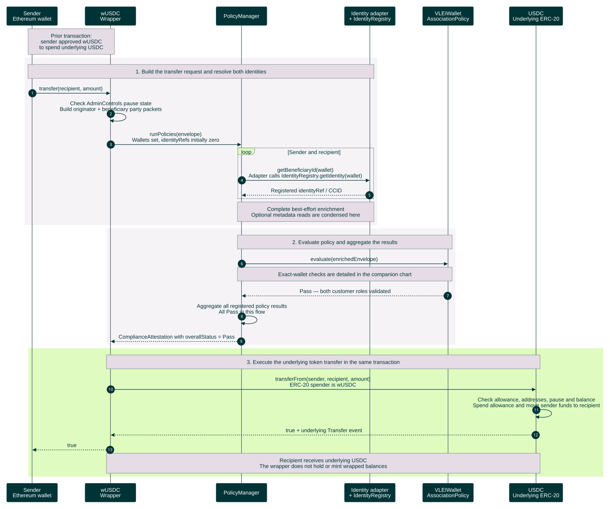

# On-chain compliance and USDC transfer

Successful call flow for the direct-wallet `wUSDC.transfer(recipient, amount)` path, grounded in `vlei-comply` commit `6220cd7`. All required policies pass and token checks succeed in this chart. The wallet-association policy must be registered in `PolicyManager`; both parties' identity mappings and endorsements come from the earlier [oracle endorsement workflow](oracle-endorsement-sequence.md).

[Open the rendered chart](on-chain-transfer-sequence.svg) · [Workflow guide](README.md) · [End-to-end overview](stablecoin-end-to-end-sequence.md)



<details>
<summary>Editable Mermaid source</summary>

Render exports on an opaque white canvas to preserve this palette in light and dark viewers. Keep bottom participant labels enabled so lifelines span the full sequence.

```text
%%{init: {"theme":"base","fontFamily":"Arial, sans-serif","themeCSS":"text { font-family: Arial, sans-serif !important; }","themeVariables":{"fontFamily":"Arial, sans-serif","primaryColor":"#003336","primaryTextColor":"#FFFFFF","primaryBorderColor":"#003336","lineColor":"#6A7B7F","actorBkg":"#003336","actorBorder":"#003336","actorTextColor":"#FFFFFF","actorLineColor":"#6A7B7F","signalColor":"#003336","signalTextColor":"#003336","labelBoxBkgColor":"#DFFBC0","labelBoxBorderColor":"#6A7B7F","labelTextColor":"#003336","loopTextColor":"#003336","noteBkgColor":"#E5DCE6","noteBorderColor":"#6A7B7F","noteTextColor":"#003336","sequenceNumberColor":"#FFFFFF"},"sequence":{"mirrorActors":true,"actorMargin":24,"width":150,"height":55,"messageMargin":25,"noteMargin":12,"diagramMarginX":20,"diagramMarginY":20,"wrap":false,"actorFontFamily":"Arial","messageFontFamily":"Arial","noteFontFamily":"Arial"}}}%%
sequenceDiagram
    autonumber
    participant S as Sender<br/>Ethereum wallet
    participant W as wUSDC<br/>Wrapper
    participant M as PolicyManager
    participant I as Identity adapter<br/>+ IdentityRegistry
    participant P as VLEIWallet<br/>AssociationPolicy
    participant T as USDC<br/>Underlying ERC-20

    Note over S,W: Prior transaction:<br/>sender approved wUSDC<br/>to spend underlying USDC
    rect rgb(246, 243, 247)
        Note over S,I: 1. Build the transfer request and resolve both identities
        S->>W: transfer(recipient, amount)
        W->>W: Check AdminControls pause state<br/>Build originator + beneficiary party packets
        W->>M: runPolicies(envelope)<br/>Wallets set, identityRefs initially zero
        loop Sender and recipient
            M->>I: getBeneficiaryId(wallet)<br/>Adapter calls IdentityRegistry.getIdentity(wallet)
            I-->>M: Registered identityRef / CCID
        end
        Note over M,I: Complete best-effort enrichment<br/>Optional metadata reads are condensed here
    end

    rect rgb(246, 243, 247)
        Note over M,P: 2. Evaluate policy and aggregate the results
        M->>P: evaluate(enrichedEnvelope)
        Note over M,P: Exact-wallet checks are detailed in the companion chart
        P-->>M: Pass — both customer roles validated
        M->>M: Aggregate all registered policy results<br/>All Pass in this flow
        M-->>W: ComplianceAttestation with overallStatus = Pass
    end

    rect rgb(223, 251, 192)
        Note over W,T: 3. Execute the underlying token transfer in the same transaction
        W->>T: transferFrom(sender, recipient, amount)<br/>ERC-20 spender is wUSDC
        T->>T: Check allowance, addresses, pause and balance<br/>Spend allowance and move sender funds to recipient
        T-->>W: true + underlying Transfer event
        W-->>S: true
        Note over W,T: Recipient receives underlying USDC<br/>The wrapper does not hold or mint wrapped balances
    end
```

</details>

The identity lane groups `ChainlinkCCIDIdentityAdapter` and `IdentityRegistry`: the adapter resolves the registered wallet-to-CCID mapping, where the CCID is the AID-derived `identityRef`. Optional credential metadata enrichment is condensed; it does not decide this wallet-association policy. See [exact-wallet endorsement evaluation](wallet-endorsement-evaluation-sequence.md) for the policy, checker and endorsement-registry calls. A Pass from this policy is only one input: the wrapper requires the aggregate result across all registered policies to be Pass.

All calls after `transfer` execute within one Ethereum transaction. See [transfer outcomes and failures](on-chain-transfer-outcomes-sequence.md) for policy Fail/Pending, token reverts and their effects on state and logs.

`PolicyManager` emits `PoliciesRun` and returns the aggregate result. Verify the underlying USDC `Transfer` event and balances: transaction receipt success alone does not prove token movement. The registry reads consume previously posted state; no oracle HTTP call, KERI/EIP-712 verification, or credential-expiry check occurs here. Direct transfers of underlying USDC bypass this wrapper policy.

Sources: [wrapper](../../gl1/vlei-comply/src/wrappers/wUSDC.sol), [policy manager](../../gl1/vlei-comply/src/policy/PolicyManager.sol), [identity adapter](../../gl1/vlei-comply/src/identity/ChainlinkCCIDIdentityAdapter.sol), [identity registry](../../gl1/vlei-comply/src/identity/IdentityRegistry.sol), [wallet association policy](../../gl1/vlei-comply/src/policies/VLEIWalletAssociationPolicy.sol), [endorsement checker](../../gl1/vlei-comply/src/attestation/VLEIEndorsementChecker.sol), [endorsement registry](../../gl1/vlei-comply/src/attestation/VLEIOracleRegistry.sol), [demo USDC](../../gl1/vlei-comply/src/assets/USDC.sol), and [compliance tests](../../gl1/vlei-comply/test/VLEIOracleComplianceTest.t.sol).
