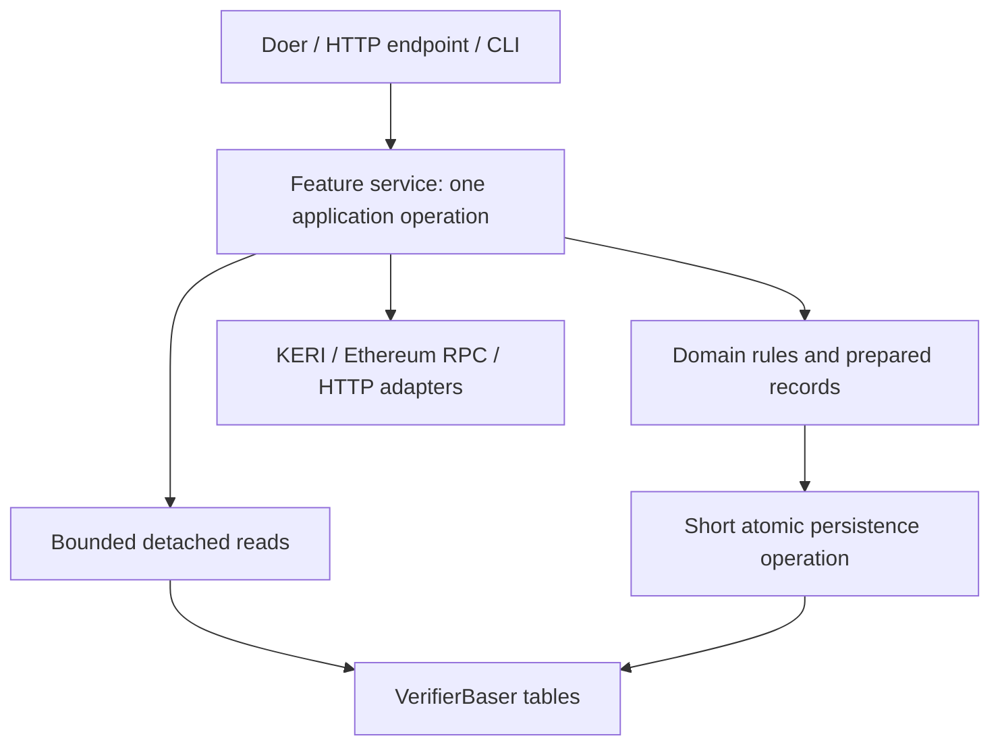

# Separate application work from persistence and transport

Status: Implemented in five slices. Final qualification evidence is recorded in the linked PRs.
Scope: eoa-verifier application code, its tests and affected integration tooling.
Source reviewed: `3a36fe33642de0ae8c2bdc1f940417eb13301f54` (runtime tree from the merged naming refactor).
Dependency reference: installed GLEIF KERI 1.2.19 and HIO 0.6.22, as pinned in pyproject.toml.

## Decision and diagnosis

Services decide what should happen. Database code reads detached data and persists
prepared records. A unit of work is an explicit application operation that reads,
decides, prepares and commits one durable phase transition for one item. It is not
a database transaction covering the operation's entire lifetime.

At the reviewed baseline, VerifierBaser exceeded that boundary: it chooses queue priority, charges
retry budgets, selects dead letters, creates rejection outcomes, constructs status
events and performs startup policy checks. Several doers also combine scheduler,
application, protocol and storage concerns. ADR 0004 explicitly placed application
transitions and event construction in persistence; that decision needs refinement.

This is an architectural separation, not evidence of network I/O inside current
application write transactions. Those transactions are synchronous today. Preserve
their useful atomic write groups while moving their decisions out.

Normal operation has one HIO-owned application worker per phase and one service
owner of its store. Manual retry requires the service stopped. Do not introduce
multiworker scheduling, mutexes, a generic concurrency protocol or long-lived
read/write sessions. Independent-process nonce contention remains an explicitly
tested integrity boundary, not a reason to wrap every business read in a writer.

## Baseline inventory and responsibility changes

| Current location | Mixed responsibilities | Target ownership |
| --- | --- | --- |
| `persistence/basing.py:begin_grant`, `settle_grant`, `retry_grant` | Active/due/new priority, attempt accounting, outcome messages, retry deadlines, phase selection and writes | Grant replay service decides; detached reads supply candidates; writer commits the chosen records/index changes |
| `next_verification`, `defer_verification`, `finish`, `retry_verification`, `stop_acceptance`, `retry_acceptance` | Retry and completion policy plus atomic queue/result updates | Verification and acceptance services decide; persistence applies each prepared transition |
| `accept`, `apply_revocation`, `_status_delivery`, `nonce_key` | Acceptance prerequisites, protocol validation, nonce-conflict policy, status/event construction, serialization and writes | Association services and event builder prepare outcomes; writer enforces uniqueness and commits status/claim/outbox together; key encoding remains persistence-owned |
| `next_delivery`, `record_attempt`, `delivery_result`, `retry_delivery` | Work selection, attempt/error state, success inference from empty error, schedule reset and table updates | Delivery service chooses explicit outcomes and schedule values; writer persists prepared delivery/phase/schedule records |
| `bind_verification_scope`, `validate_nonce_history`, `_read_claim` | Startup trust policy, cross-record integrity decisions and full-history reading | Delete the history audit and paging; bootstrap checks one scope record; the nonce key alone enforces consumption |
| `first_record`, `due_record`, `verification_progress` | Mostly storage queries; `due_record` also consumes an index and decides eligibility | Detached read functions; querying never consumes work or chooses retry policy |
| `receiving/grants.py:GrantNotificationDoer` | KERIpy notice access, EXN decoding, parser replay, retry policy and application writes inside a scheduler adapter | KERIpy Grant adapter handles KERI mechanisms; replay service orchestrates; doer schedules one item |
| `verification/coordinating.py:VerificationCoordinator` | HIO request/cue plumbing, evidence decisions and direct application-table access | Verification service owns attempts/results/rechecks; coordinator handles scheduling and correlation |
| `verification/credentials.py` | KERIpy KERI retrieval/read-through caches, schema/anchor mechanisms and application LE/QVI/issuer policy | Evidence adapter exposes detached facts and KERIpy validation results; credential rules evaluate trust/profile requirements |
| `verification/worker.py:EoaVerifierDoer` | Wallet proof policy, RPC client lifetime/result decoding, retry classification and cue construction | Account-observation adapter owns RPC mechanics; verification service owns proof/account policy and outcome classification; doer drives the exchange |
| `associations/accepting.py`, `revoking.py` | Scheduling, direct KERIpy/application reads, eligibility decisions and multi-store sequencing | Acceptance/revocation services own the operations; doers delegate; KERIpy evidence adapter exposes facts and revocation identifiers |
| `associations/statusing.py:StatusEnd` | Falcon handling, multi-table reads, phase precedence and response construction | Status query service builds the detached view; endpoint maps it to HTTP |
| `delivery/delivering.py:WebhookSender` | Queue access, attempt budgets/backoff, HTTP lifecycle, authentication/ACK policy and persistence | Delivery service owns progression; HTTP adapter owns I/O; explicit ACK rules and authentication service produce outcomes |
| `delivery/authing.py:ServiceAuthenticator` | Key retrieval, signature mechanics, trust/time rules and replay consumption | Keep a clearly named authentication service; separate signature codec from its key and replay-store dependencies; successful authentication explicitly includes nonce claiming |
| `runtime/serving.py:VerifierService.__init__` | Composition plus scope/history checks, inception-file reading, schema installation and identity bootstrap | Explicit bootstrap operation precedes composition; runtime retains resource and HIO lifetime ownership |
| `runtime/cli.py` retry dispatch | Commands invoke workflow methods on the database object | CLI opens resources and invokes the owning service's retry operation |
| `scripts/integration/receiver.py` | HTTP handling, receipt/conflict decisions, several writes and ACK-loss injection | Small fixture receipt operation separates durable receipt behavior from HTTP and fault injection; keep it a focused fixture |

Keep existing boundaries that already fit: pure EOA challenge/proof functions in
`verification/eoa.py`, the JSON-RPC envelope adapter in `verification/rpc.py`, CESR
HTTP framing and parser/escrow scheduling in `receiving/directing.py`, configuration
validation in `runtime/config.py`, and process/artifact helpers in integration
tooling. Update their callers when needed; do not invent a new layer for each helper.
IssuerCeremony is already an application workflow with separate store/scheduler
ownership. Preserve that separation and the KERIpy issuance topology.

Names identify the protocol or implementation precisely. `IpexGrantAdapter`
bridges KERIpy notification/EXN/parser operations; do not use “Native” as a general
adapter label because it conflicts with CESR-native terminology. Tests retain
explicit notifier/parser/service handles instead of traversing doer internals.

## Target organization

Keep topical sibling packages. Introduce only the seams used by the next vertical
slice; these are responsibility placements, not a one-class-per-file mandate.

- `persistence/basing.py`: LMDBer construction, directory constants, table binding
  and resource lifecycle. No clock, retry limit, business outcome or webhook JSON.
- `persistence/reading.py`: explicit point/head queries returning detached values.
- `persistence/writing.py`: concrete atomic save operations over prepared records.
  Split by feature only if the actual implementation warrants it, not per table.
- `persistence/records.py`: retain passive serialization contracts. Services may
  prepare these DTOs; policy functions do not receive database handles. No business
  methods or infrastructure dependencies are added to record dataclasses.
- `receiving/replaying.py`: Grant replay service; `receiving/grants.py` retains the
  KERIpy Grant bridge and thin scheduled entry point.
- `verification/coordinating.py`: verification service and thin coordinator;
  `verification/evidence.py` isolates KERIpy evidence access;
  `verification/observing.py` isolates account RPC observation. Keep credential
  rules and EOA rules with their existing feature modules.
- `associations/accepting.py`, `revoking.py`, `statusing.py`: concrete services and
  small scheduling/HTTP adapters. `associations/events.py` owns the shared pure
  event/Delivery construction used by acceptance and revocation.
- `delivery/delivering.py`: delivery service and thin scheduled entry point;
  `delivery/httping.py` owns request/client lifetime; `delivery/signatures.py` owns
  signature parsing/base construction; `delivery/authing.py` orchestrates trusted
  keys, signature checks and replay claims.
- `runtime/bootstrap.py`: startup scope/integrity/identity/schema orchestration.
  `runtime/serving.py` composes dependencies and retains store/socket shutdown order.

The runtime injects concrete read/write and external-effect adapters. Services use
small operation contracts, not the full VerifierBaser, LMDB transactions, Falcon
requests or cursor iterators. Add a Protocol only when it clarifies an actual
substitution; no dependency-injection container, generic repository, command bus,
ORM, tracked-entity session or arbitrary write-command language.

A service operation is the unit-of-work boundary. It may call several bounded
reads, calculate values and invoke one commit operation. Do not add a long-lived
`with unit_of_work:` context around reads, cryptography or I/O. Durable preparation
before an effect and durable completion afterward are separate units of work.

## Read and write contracts

Reads return records, copied bytes, tuples or explicit small fact objects. Close
readers before returning and before any HIO yield, KERIpy parser call, network
request or application decision. Copy LMDB buffers while their transaction is
owned. Never expose an LMDB cursor, transaction, live iterator or mutable KERIpy
Kever/Tever as a service snapshot.

Ordinary queue selection reads a head or identified record, not a complete table.
A due-index query returns its deadline and record without deleting the index; the
service compares the deadline to its clock. A subsequent chosen transition commits
the index removal and record movement together. Preserve priority and fairness
behavior, including fresh notices progressing when another Grant is waiting.

The pinned Komer point get closes its underlying read transaction, whereas
getItemIter delegates to a generator whose LMDB reader remains open across yields.
Keep that distinction visible in adapter contracts. Nonce consumption uses the
exact nonce key with no-overwrite insertion. Delete full-history audits and their
paging helpers; startup does not traverse accepted nonces or associations.
Scope checks that only need to know whether history exists read a head record;
they do not count every row.

Application services validate inputs, choose phases, construct final records and
build immutable webhook bytes before persistence. The writer encodes keys and
serializes records before opening its write transaction. Within the transaction:

1. Check only necessary storage preconditions, such as the expected source item,
   existing immutable result, absence of an association or unique nonce ownership.
2. Apply that operation's prepared inserts/updates/deletes, including queue indexes.
3. Commit, or abort completely and report a concrete conflict/integrity failure.

No workflow callback, clock lookup, budget decision, network call or policy
calculation runs inside the writer. Each write method names a concrete transition and fixes its write set. Services
choose separate methods for local-only acceptance versus acceptance with delivery,
verified versus rejected completion, and delivery acknowledgment versus deferral
or dead letter. No source/target phase strings, direction flags, optional outcome
records or catch-all transition function select tables inside persistence. Repeat
short transaction bodies where necessary to make each legal transition readable.
Use explicit outcome values at service boundaries rather than inferring success
from an empty error string.

These short guards are not a proposal for phantom-read protection or a generalized
optimistic-concurrency framework. Preserve insert-without-overwrite for accepted
and authentication nonces. Preserve source identity checks where a late completion
could otherwise remove another queue item. Normal detached read/prepare/commit
segments run synchronously without yielding. Refresh relevant facts after actual
I/O yields; do not pretend an earlier read remains authoritative afterward.

## Concrete Grant slice

Replace begin_grant with an application operation that:

1. Reads the active Grant record, otherwise the due waiting head, otherwise the
   next KERIpy notice. All reads are detached.
2. Applies priority, deadline and attempt-budget policy outside transactions.
3. Constructs the updated GrantReplayRecord, chosen phase and any due-index data.
4. Commits the selected application record/index changes through the writer.
5. Only after that commit, acknowledges the KERIpy notice and attempts replay.
6. On replay completion or failure, prepares and commits the next phase in a
   separate application operation. Invalid input, unavailable material and internal
   failures retain their current distinct outcomes.

KERI replay owns KERIpy transactions and cannot join the application transaction.
Preserve restart recovery when notice removal or replay succeeds before application
completion. The service identifies the complete application write set: successful
replay can enqueue its verification record and settle its Grant record together in
one application commit. Treat that consolidation as an explicit transaction-boundary
change, cover its rollback, and preserve duplicate semantics. Do not hide parser
execution in a persistence callback or add a generic multi-item batch API.

## Atomicity that must survive extraction

| Unit | Prepared writes that commit together |
| --- | --- |
| Grant transition | Source/destination phase records and due-index changes; successful application completion also enqueues verification idempotently |
| Verification claim/defer/completion | Active/waiting/dead membership and due index; completed result plus acceptance obligation and removal of active verification |
| Acceptance | Accepted nonce claim, association status, optional immutable Delivery and ready reference, optional destination initialization, acceptance removal |
| Nonce-conflict rejection | Rejected association status and acceptance removal; no new nonce claim or outbox event |
| Revocation | Revoked status and immutable second Delivery/reference when configured |
| Delivery attempt | Updated attempt record and request-start schedule |
| Delivery completion/defer/dead letter | Prepared delivery progress, destination schedule and matching phase references |
| Manual retry | Prepared reset record, phase movement and due index where applicable |
| Transport authentication | Atomic no-overwrite replay claim after signature/context validation |

For acceptance, the service reads existing status and prepares the outcome.
The successful acceptance writer still uses no-overwrite nonce insertion. If a
competing process wins, abort the whole attempted acceptance and return a nonce
conflict; do not manufacture NONCE_REUSED inside persistence. The service prepares
rejection based solely on the key conflict, without decoding or following its value. A crash between
these operations leaves acceptance work recoverable. Same-SAID races return the
already committed status; every existing nonce key denies a new credential. Preserve the current
independent-process and process-death tests. Do not add an acceptance/reservation
state where a consumed nonce exists without its accepted association.

Verified TEL revocation is a deliberate exception to moving every atomic write out
of the KERIpy database extension. VerifierReger.putTel must continue committing the
accepted KERIpy TEL index and revocation identifiers together. This is a KERIpy
persistence projection, not application revocation policy. Revocation service first
commits the application status/event, then removes the KERIpy revocation record;
replay between those commits remains idempotent. No cross-environment transaction.

## Other service boundaries to preserve

- Credential evidence: preserve KERIpy acceptance versus candidate bytes, schema
  checks, GEDA delegation, LE/QVI linkage and witnessed anchors. Use KERIpy KERI
  validation mechanisms rather than implementing a parallel verifier. Re-read
  relevant local evidence after RPC completion and before acceptance, as today.
- Account observation: adapter validates RPC envelopes/quantities and closes each
  client; service distinguishes invalid proofs/accounts from unavailable RPC. Keep
  identified-block code reads and current timeout semantics.
- Authentication: pure signature operations do not mutate state. The authentication
  service explicitly verifies and claims the transport nonce before returning
  authenticated success. Do not accidentally make a caller responsible for an
  optional replay check. Preserve current ACK body/signature/correlation ordering.
- Delivery: keep durable attempt accounting before POST, identical event bytes on
  retry, bounded attempts, destination cooldown and authenticated ACK rules. A late
  result must not remove a different active reference or change association status.
- Query: build status views from a bounded set of detached records. The endpoint
  only handles HTTP representation/errors. No RPC, work discovery or scheduling.
- Offline retry: expose narrow feature operations taking only application-store
  adapters and identifiers. Do not instantiate a live replay/verification worker,
  bootstrap a habitat or require RPC merely to reset a dead letter.
- Startup: move scope/history rules above storage; isolate identity/inception and
  schema installation from service assembly. Partial startup still closes acquired
  resources; shutdown stops child doers before their borrowed stores close.
- Fixture receiver: separate receipt persistence from HTTP and deliberate ACK-loss
  behavior. Preserve its diagnostic API and fault timing; do not grow it into an
  alternative production Oracle or adopt its fixtures as application policy.

## Implementation sequence

1. **Grant replay vertical slice.** Introduce the first detached reads and concrete
   commits, extract the replay service/KERIpy adapter boundary, wire the doer and
   retry-grant command, delete replaced Baser methods and update ADR 0004. Prove the
   intended pattern on actual use cases before extracting other slices.
2. **Verification and evidence.** Move claim/retry/completion decisions to the
   verification service; separate KERIpy evidence access and account observation
   from policy and HIO scheduling. Wire retry-verification and delete old methods.
3. **Association lifecycle and status.** Move acceptance/rejection, revocation and
   event construction above storage; extract the status query and fixed-key startup scope
   checks. Wire retry-acceptance. Preserve nonce contention and both
   KERIpy/application and status/outbox commit gaps explicitly.
4. **Delivery and authentication.** Separate retry/ACK/application progression from
   HTTP effects and signature mechanics. Wire retry-delivery, retain mandatory
   replay claims, and remove the corresponding policy-bearing Baser methods.
5. **Composition, tooling and final qualification.** Complete bootstrap extraction,
   update fixture adapters/documentation and remove any remaining obsolete entry
   points. Verify Baser contains only table/lifecycle responsibility and that no
   application caller reaches into its tables or transaction handles.

Each slice updates production callers, tests and imports together. Delete replaced
APIs in the same PR rather than retaining compatibility facades. Keep the existing
stored/wire representations where extraction permits; a gratuitous schema change
is not a goal. If an actual simplification requires a break, document fresh-store
selection and provide no migration, alias or old-format reader.

Oracle/Comply architecture changes are outside this plan. Advance Oracle's exact
producer pin only as needed for final qualification. Preserve maintained paired
qualification and the qualified contract revision.

## Implementation evidence

- Slice 1: [PR #28](https://github.com/GLEIF-IT/eoa-verifier/pull/28), Grant service/KERIpy adapter and atomic replay completion. Focused checks: 25 passed.
- Slice 2: [PR #29](https://github.com/GLEIF-IT/eoa-verifier/pull/29), verification service, KERIpy credential evidence and account observation adapters. Focused checks: 119 passed; installed-wheel CI gates merge.

- Slice 3: [PR #30](https://github.com/GLEIF-IT/eoa-verifier/pull/30), acceptance/revocation services, status query, atomic conflict handling. The temporary nonce audit/page design from this slice is deleted by slice 5: direct nonce keys replace it.

- Slice 4: [PR #31](https://github.com/GLEIF-IT/eoa-verifier/pull/31), delivery service with explicit outcomes, owned HTTP adapter, pure signature codec and KERIpy key adapter. Focused checks: 106 passed; late-completion and public revocation checks passed.

- Slice 5: [PR #32](https://github.com/GLEIF-IT/eoa-verifier/pull/32), bootstrap and fixture receipt separation, final documentation, and explicit named persistence transitions throughout. Removed the intermediate `move_grant`, `move_verification`, directional acceptance and flag-driven delivery saves. Focused transition/lifecycle checks: 89 passed. Final adapter/runtime/receipt checks: 26 passed. Installed-wheel CI: 249 passed. Tests use explicit runtime notifier/parser/replay-service handles; the duplicate-Grant lookup closes its reader before replay.

Coordinated qualification: [Oracle PR #59](https://github.com/GLEIF-IT/vlei-oracle/pull/59)
advances the exact verifier pin while retaining contract
`d6083e34fbe57641cdc0e7253db18f14ce1e4a35`. The initial application-separation
candidate passed 249 installed-wheel Verifier tests and 73 Oracle tests including
paired qualification. The phase-specific follow-up below is requalified before
merging; current revisions and final results are recorded in those PRs.

### Phase-selection and nonce-key follow-up

- Nonces: use the exact nonce as the key across all issuers. Delete history audits,
  paging and claim-owner traversal. The value records only the accepted SAID;
  every existing key denies a new credential. Use fresh stores without migrations.
- Verification: replace the combined selector with detached `next_verifying`,
  `next_waiting` and `next_pending` reads. The coordinator explicitly schedules
  one phase; writer names identify the fixed table transition.
- Grant replay: separate active, due waiting and KERIpy notice reads from resume,
  retry and first-attempt operations. Preserve acknowledgement after persistence.
- Delivery: separate active and ready reads; claiming ready-to-active is explicit.
- Oracle posting: remove `begin_operation`, string-directed `move_operation` and
  phase-directed failure handling. Use separate queued/preparing/pending reads,
  fixed phase transitions and distinct preparation/pending failure operations.
  Offline retry policy prepares records above storage, preserving signed bytes
  and the unresolved-transaction fence. This extends the coordinated Oracle PR
  beyond its original pin-only scope.
- Acceptance and revocation already read one dedicated queue. Cross-phase status
  lookups remain bounded, read-only queries for one identifier. Comply has no
  corresponding queue-selection or generic phase-transition API.

No compatibility selector remains. Qualification covers exhausted-item turns,
restart/cooldown behavior, atomic journal rollback, signed dead-letter fencing,
and the maintained paired scenario.

## Validation and completion criteria

Use focused existing tests first. Add tests at changed boundaries, not tests that
mirror the implementation or scripted architecture/doc checks.

- Service tests use detached records and explicit clocks to exercise queue priority,
  retries, invalid-input classification, event construction and manual recovery.
- Persistence tests use actual LMDB to prove prepared multi-record atomicity,
  no-overwrite behavior, duplicate/conflict semantics and rollback on a later write.
- Reader-lifetime tests exercise the adapter boundary and I/O suspension. Verify a
  returned value remains usable after the reader closes and that no cursor/reader
  survives while effects run. Do not add production transaction instrumentation.
- Require existing nonce keys to deny reuse without decoding their values. Preserve
  independent-process contention and pre/post-commit
  process-death tests; move business outcome assertions to service tests where needed.
- Preserve Grant acknowledgement/reopen gaps, RPC interruption, evidence arriving
  during a wait, revocation before acceptance, immutable delivery retry, lost ACK,
  cancellation/client cleanup and no-history-scan scheduling.
- Keep real KERIpy KERI/IPEX and witnessed integration tests. Fixtures enter through
  services or explicit prepared-storage setup; they do not call obsolete Baser
  workflows or inject acceptance into the paired scenario.
- Run the full Verifier suite against a fresh wheel outside the checkout for slices
  changing durable boundaries. At the final coordinated revision run the full
  installed-wheel Oracle suite and maintained paired qualification. Do not restore
  deleted combined-runtime fixtures, weaken assertions or change witness topology.

Completion means services own every application decision listed in the inventory;
transaction ownership is confined to concrete persistence/KERIpy adapters; reads
are detached before decisions/effects; and all durable boundaries remain qualified.
Review the dependency direction and source manually. No architecture-check script,
docs-check script, generic repository framework, extra locking or compatibility API
is part of this work.

## Revocation terminology follow-up

The issuer issues credential TEL revocation; KERIpy validates the evidence; the
verifier applies it to local association status. Oracle receives revoked status
and withdraws an endorsement. Replacement supersedes an association without
revoking its credential. Deleted functionality is removed.

The associations module is `revoking.py`, with `RevocationService`,
`RevocationDoer` and `apply_revocation(credSaid)`. Persistence uses
`record_revocation` and `record_revocation_and_queue_delivery`; test composition
uses `revocation_service`. Oracle's qualification operation is
`revoke_associations`, and contract withdrawal retains `withdrawEndorsement`.
Comply describes removed APIs and delayed endorsement withdrawal explicitly.

This follow-up changes Python API names and terminology only. Preserve wire
values, LMDB keys/layout, event IDs, atomic writes, phase operations and direct
nonce consumption. No aliases or fallback imports remain. Coordinated PRs record
focused, installed-wheel and paired qualification evidence and exact pins.

Review and qualification: [Verifier #33](https://github.com/GLEIF-IT/eoa-verifier/pull/33),
[Oracle #60](https://github.com/GLEIF-IT/vlei-oracle/pull/60), and
[Comply #19](https://github.com/GLEIF-IT/vlei-comply/pull/19). Focused checks passed:
40 verifier revocation/delivery/IPEX cases, 4 registry recovery cases after the
final variable rename, 23 Oracle selection/receipt/posting cases, and 20 Comply
wallet-association cases. Those PRs record final installed-wheel and paired test
results against the exact coordinated pins before merge.
