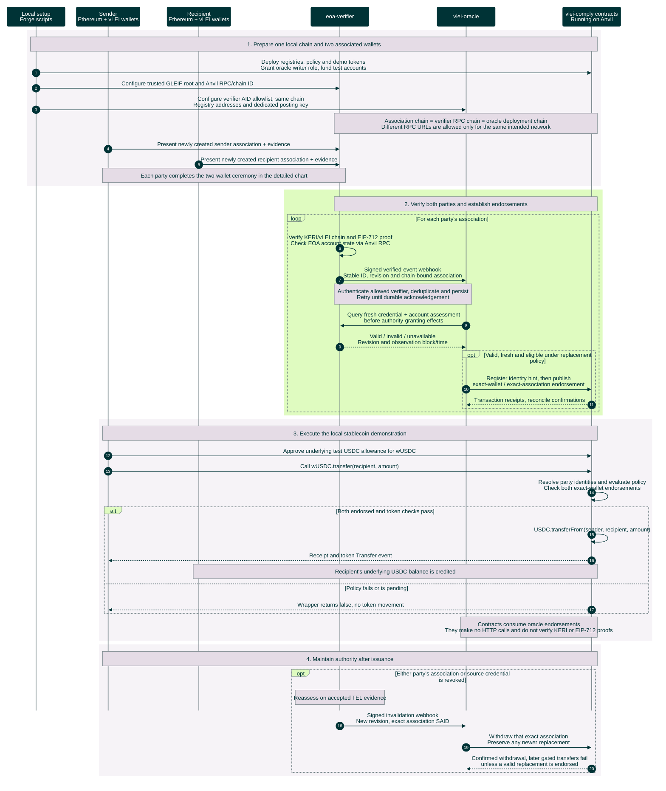

# Verified wallet associations and stablecoin transfers

Proposed local end-to-end workflow. Both parties first establish an EOA association. `eoa-verifier` owns cryptographic verification and current-status queries; `vlei-oracle` authenticates results and manages on-chain endorsements. Forge deploys the demo; Anvil runs its Ethereum chain.

[Open the rendered chart](stablecoin-end-to-end-sequence.svg). The detailed ceremony is in [EOA association creation and verification](association-verification-sequence.md).

The transfer path is the local **policy-controlled stablecoin wrapper** (`wUSDC`), with test balances prepared in setup; a direct transfer of the underlying mock USDC does not enforce this policy. Check the underlying `Transfer` event and balances: a successful receipt alone does not prove a transfer, because a policy failure can return `false`. Anvil executes the transactions. Forge is deployment/test tooling, not a participant in each transfer.

Freshness checks gate new authority and recovery/rebroadcast. Unavailable evidence blocks new authority but, under the current plan, leaves existing endorsements in place. Revocation has propagation and transaction-confirmation latency; transfers already confirmed are not undone. The contracts do not provide an automatic expiry bound. The oracle retains durable transaction, nonce, cancellation and reorg recovery behind the simplified arrows.

Sources: [EOA profile](/Users/kbull/gleif/projects/vlei-external-association/initial-docs-from-kevin/eoa-profile.docx), [methodology and original color theme](/Users/kbull/gleif/projects/vlei-external-association/initial-docs-from-kevin/methodology.docx), [wallet association policy](../../gl1/vlei-comply/src/policies/VLEIWalletAssociationPolicy.sol), [oracle registry](../../gl1/vlei-comply/src/attestation/VLEIOracleRegistry.sol), and [wrapped token](../../gl1/vlei-comply/src/wrappers/wUSDC.sol). Contract behavior is grounded in local `vlei-comply` commit `6220cd7`; the separate verifier and webhook/query boundary are planned.
